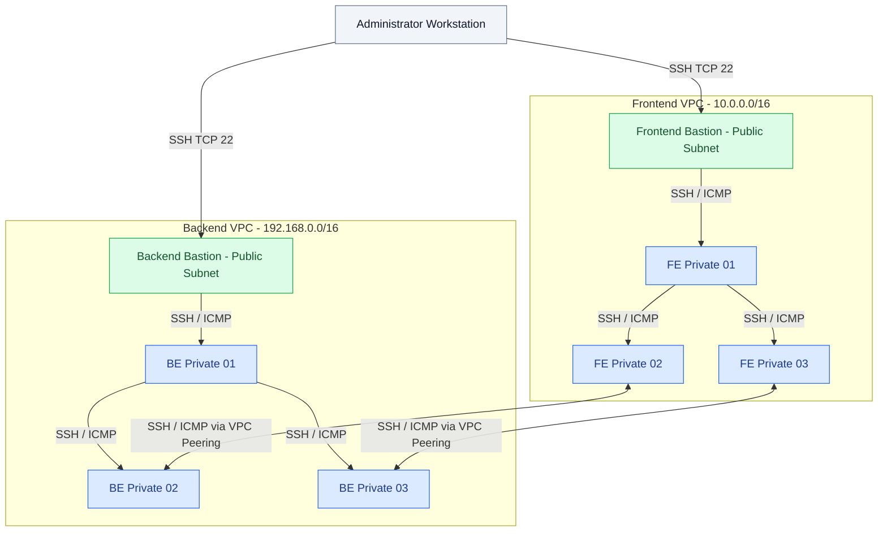
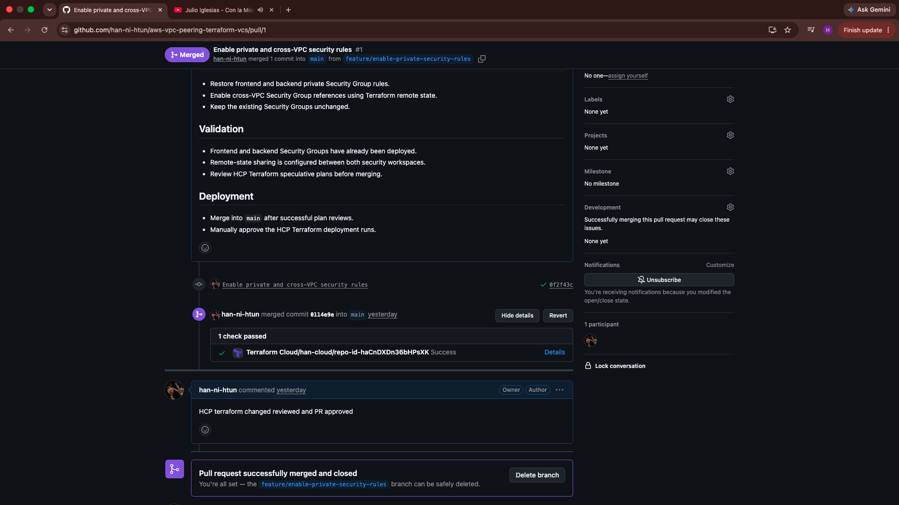
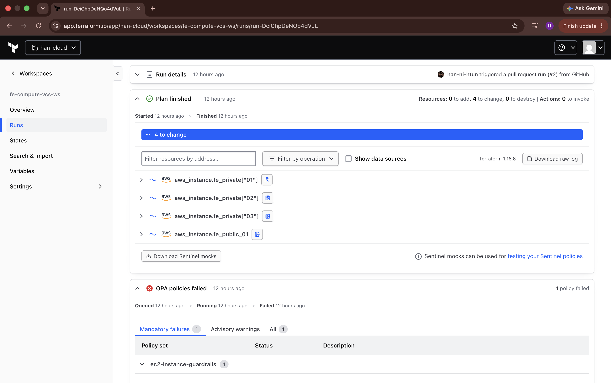

# AWS VPC Peering with Terraform — GitHub CI/CD & HCP Terraform

**A multi-VPC AWS infrastructure project demonstrating Infrastructure as Code (IaC), GitHub-driven CI/CD pipelines, HCP Terraform, OIDC authentication, and Open Policy Agent (OPA) policy enforcement.**


## Overview

This project demonstrates how to build and validate a multi-VPC network in AWS using Infrastructure as Code (IaC). A frontend VPC and a backend VPC are deployed in the **Asia Pacific (Singapore) (`ap-southeast-1`)** Region, connected by an AWS VPC peering connection, and configured with subnet-specific routing and least-privilege network access rules.

Infrastructure is separated into **network**, **security**, and **compute** layers for each VPC. HCP Terraform manages remote execution and state, and AWS access from HCP Terraform is authenticated through **OIDC-based dynamic provider credentials** rather than long-lived AWS access keys.


This project implements a GitHub-driven CI/CD workflow using HCP Terraform. Infrastructure changes are submitted through pull requests, which automatically trigger speculative Terraform plans for validation. After a pull request is merged into the protected `main` branch, HCP Terraform triggers a deployment plan that requires manual approval before changes are applied to AWS.

An OPA policy set provides an additional policy-as-code validation stage, rejecting disallowed EC2 instance types before deployment.


### Key capabilities

- Two isolated VPCs with non-overlapping IPv4 CIDR ranges.
- Three Availability Zones per VPC, with three public and three private subnets in each VPC.
- Internet Gateways, NAT Gateways, and public/private route tables.
- Private routing between designated subnet pairs through VPC peering.
- Security Groups with separately managed ingress and egress rules.
- Eight EC2 instances: one public jump host and three private hosts per VPC.
- SSH jump-host design using OpenSSH ProxyJump without transferring the private SSH key to EC2 instances.
- Six HCP Terraform workspaces with remote-state dependencies.
- GitHub pull-request review with HCP Terraform speculative plans, manual apply, branch protection, and OPA policy enforcement.

## Architecture


### Network connectivity




> **Network design:** Cross-VPC routes and Security Group rules are configured for the designated Private 02 and Private 03 pairs. The arrows represent intended communication paths, not proof of successful connectivity testing.

### Network layout

| Component | Frontend | Backend |
| --- | --- | --- |
| VPC CIDR | `10.0.0.0/16` | `192.168.0.0/16` |
| Public subnets | 3, across 3 Availability Zones | 3, across 3 Availability Zones |
| Private subnets | 3, across 3 Availability Zones | 3, across 3 Availability Zones |
| Public EC2 | 1 × Amazon Linux 2023 | 1 × Amazon Linux 2023 |
| Private EC2 | 3 × Ubuntu 24.04 | 3 × Ubuntu 24.04 |
| EC2 size | `t3.micro` | `t3.micro` |
| Internet Gateway | 1 | 1 |
| NAT Gateway | 1 | 1 |
| Public/private route tables | Configured | Configured |
| VPC peering | Shared connection | Shared connection |

The peering connection supports routing between the intended private subnet pairs. **VPC peering is not transitive**; it does not automatically provide connectivity to other VPCs or act as a gateway for internet access.

## Repository structure

```text
aws-vpc-peering-terraform-vcs/
├── assets/           # Architecture diagram and CI/CD validation screenshots
├── fe-network/       # Frontend VPC, subnets, gateways, and routing
├── be-network/       # Backend VPC, subnets, gateways, peering, and routing
├── fe-security/      # Frontend Security Groups and individual rules
├── be-security/      # Backend Security Groups and individual rules
├── fe-compute/       # Frontend EC2 instances and AWS SSH key pair
├── be-compute/       # Backend EC2 instances and AWS SSH key pair
├── .gitignore
└── README.md
```

Each directory is a **separate Terraform root configuration**, connected to its own HCP Terraform workspace. The project intentionally does not use Terraform modules; this makes the dependency boundaries and resource definitions explicit.

## HCP Terraform workspaces

| Directory | Workspace | Responsibility |
| --- | --- | --- |
| `fe-network/` | `fe-network-vcs-ws` | Frontend VPC and network resources |
| `be-network/` | `be-network-vcs-ws` | Backend VPC, networking, and peering connection |
| `fe-security/` | `fe-security-vcs-ws` | Frontend Security Groups and ingress/egress rules |
| `be-security/` | `be-security-vcs-ws` | Backend Security Groups and ingress/egress rules |
| `fe-compute/` | `fe-compute-vcs-ws` | Frontend EC2 instances and public SSH key registration |
| `be-compute/` | `be-compute-vcs-ws` | Backend EC2 instances and public SSH key registration |

The workspaces use **remote execution and remote state**. Required identifiers are exported as outputs and consumed via `terraform_remote_state` instead of being copied into configuration as fixed resource IDs. Security-layer configurations reference the network-layer outputs; compute configurations consume network and security outputs. The two security configurations also reference peer Security Group IDs.

Cross-workspace state access must be authorized through HCP Terraform's state-sharing controls.

### Version Control Workflow

GitHub serves as the source of truth for Terraform configuration. Each HCP Terraform workspace connects to the same repository but uses its own working directory and independent Terraform state.

Changes pushed to the configured branch trigger workspace plans according to the workspace's run-triggering settings. The project uses manual apply approval to review infrastructure changes before provisioning AWS resources.

Pull requests provide an opportunity to review infrastructure changes before merging them into the deployment branch.

## Security design

### AWS authentication

HCP Terraform authenticates to AWS using short-lived dynamic provider credentials configured through AWS Quick Setup. This establishes the required AWS trust configuration and IAM role integration without manually writing the complete IAM trust setup.

Workspace-specific IAM roles were created using AWS Quick Setup. Broad AWS-managed permissions (including `AmazonVPCFullAccess` and, for compute roles, `AmazonEC2FullAccess`) were used for this temporary lab. A production deployment should replace these with carefully scoped least-privilege policies. Long-lived AWS access keys are not stored in the repository.

No AWS access keys are required in the repository.

### SSH access

- Public jump hosts run Amazon Linux 2023 and use the `ec2-user` account.
- Private hosts run Ubuntu 24.04 and use the `ubuntu` account.
- Only an SSH **public key** is registered as an AWS EC2 key pair through Terraform.
- The corresponding **private key remains on the administrator's workstation** and must never be committed to source control.
- SSH access to public jump hosts is restricted to an administrator IPv4 `/32` CIDR.
- Private hosts have no public IPv4 addresses and are designed to be accessed through an SSH bastion using OpenSSH ProxyJump.
- EC2 instances require IMDSv2.

### Network access rules

| Source | Destination | Allowed traffic |
| --- | --- | --- |
| Configured administrator `/32` | Public jump hosts | SSH and ICMP |
| Public jump host in the same VPC | Private 01 | SSH and ICMP |
| Private 01 in the same VPC | Private 02 and Private 03 | SSH and ICMP |
| Frontend Private 02 ↔ Backend Private 02 | Matching peer | SSH and ICMP |
| Frontend Private 03 ↔ Backend Private 03 | Matching peer | SSH and ICMP |

Private 02/03 egress is intentionally limited to their matching peered Security Groups for the tested protocols. Security Groups are **stateful**, so allowed connection responses do not require a separate reverse-direction rule for each response packet. Other paths should not be presumed permitted without checking the complete effective policy.

## Prerequisites

- An AWS account with permissions to create VPC, EC2, networking, IAM, and associated resources in `ap-southeast-1`.
- An HCP Terraform organization with six workspaces, configured for remote execution and permitted remote-state access.
- Terraform CLI compatible with the repository's `required_version` constraints (developed and tested with Terraform **1.16.6**).
- AWS provider version matching each root configuration's constraint (the lab used the AWS provider **6.x**).
- AWS CLI for verification and troubleshooting.
- OpenSSH and an SSH key pair generated and stored securely on the local workstation.
- Appropriate HCP Terraform workspace variables, including an administrator `/32` CIDR and the SSH public key for compute.
- A GitHub repository connected to HCP Terraform through a VCS connection.
- Six VCS-driven HCP Terraform workspaces with their respective working directories configured.
- AWS Quick Setup authentication with IAM permissions appropriate for each workspace.

**Cost considerations:** NAT Gateways, public IPv4 addresses, EC2 instances, EBS volumes, and other AWS resources may incur charges. NAT Gateways incur hourly charges even when no traffic is being processed. Destroy the infrastructure when it is no longer needed to avoid unnecessary costs.

## Deployment workflow

Infrastructure is deployed through the HCP Terraform Version Control Workflow, with GitHub as the source of Terraform configuration.

1. **Connect GitHub.** Connect the repository to HCP Terraform and configure the appropriate working directory for each of the six workspaces.
2. **Configure AWS authentication.** Use AWS Quick Setup to establish dynamic AWS credentials and assign the necessary IAM permissions.
3. **Configure dependencies.** Enable authorized remote-state sharing between dependent workspaces.
4. **Provision networking.** Trigger and review Terraform plans for the frontend and backend networking workspaces, then approve the required applies.
5. **Provision security.** Deploy frontend and backend Security Groups, resolving cross-workspace dependencies through staged deployment where necessary.
6. **Provision compute.** Deploy the frontend and backend EC2 instances after their network and security dependencies are available.
7. **Review changes using GitHub PRs.** Run speculative Terraform plans on proposed changes and merge approved changes into protected `main`.
8. **Enforce policy as code.** Use an HCP Terraform OPA policy set to reject unapproved EC2 types before applying changes.
9. **Validate connectivity.** Record successful and unsuccessful SSH and ICMP tests separately (see below).
10. **Destroy infrastructure.** Perform dependency-aware teardown through HCP Terraform after testing.

### Change management and PR evidence

GitHub is the configuration source of truth. The `main` branch has an active ruleset named `protect-main-pr-workflow`, requiring changes to enter through Pull Requests, with zero required reviewer approvals for this solo lab. Force pushes and branch deletion are restricted. The configured ruleset was inspected, but **a rejected direct-push attempt was not independently tested**.

1. Create a feature branch and push Terraform changes to GitHub.
2. Open a Pull Request targeting `main`. HCP Terraform creates **speculative (plan-only)** runs for affected workspaces; these cannot apply infrastructure changes.
3. Review the PR and plan; merge the PR when appropriate.
4. HCP Terraform detects the updated `main` branch and starts normal runs; **manual Confirm & Apply** is required before modifying AWS.

**Observed evidence:**

- [PR #1 — Enable private and cross-VPC security rules](https://github.com/han-ni-htun/aws-vpc-peering-terraform-vcs/pull/1): speculative plans succeeded for both security workspaces (**15 add / 0 change / 0 destroy** each). After merge, both normal HCP Terraform runs were manually approved and applied, creating 15 private security rules on each side.
- [PR #2 — Test OPA denial of `t3.large`](https://github.com/han-ni-htun/aws-vpc-peering-terraform-vcs/pull/2): speculative frontend-compute run proposed changes to four EC2 instances; a **mandatory OPA policy failed**. The PR was closed without merging, and no corresponding infrastructure change was applied.

Terraform state is managed in HCP Terraform and is not committed to GitHub.

### OPA Policy as Code

An individually managed HCP Terraform **OPA** policy set named `ec2-instance-guardrails` was assigned only to `fe-compute-vcs-ws` and `be-compute-vcs-ws`. Its mandatory policy `restrict-ec2-instance-type` examines planned `aws_instance` create/update actions and denies instance types other than `t3.micro`. The policy is configured through HCP Terraform's UI; **its Rego source is not stored in this repository**.

| Test | Configuration / plan | Observed result |
| --- | --- | --- |
| Policy evaluation succeeds | Existing `t3.micro` deployment, no infrastructure changes (`0 add / 0 change / 0 destroy`) | OPA policies **passed**; validates successful execution on a no-change plan |
| Policy rejects noncompliant changes | PR #2 proposes `t3.large` for frontend EC2, `0 add / 4 change / 0 destroy` | Mandatory OPA policy **failed**; plan-only PR run could not be applied |

The first case does **not** independently exercise an allowed EC2 *creation/update*, because there were no changes; the second case does demonstrate active rejection. The `t3.large` configuration was **never merged into `main`**.


## VCS-Driven Deployment Validation

This deployment successfully provisioned the AWS infrastructure through six HCP Terraform workspaces using GitHub-driven workflows, OIDC authentication, and manual deployment approvals.

| Validation | Result |
|---|---|
| Frontend and backend infrastructure provisioning | Passed |
| VPC peering connection and route provisioning | Passed |
| [GitHub PR #1](https://github.com/han-ni-htun/aws-vpc-peering-terraform-vcs/pull/1) — speculative Terraform plans | Passed |
| [GitHub PR #1](https://github.com/han-ni-htun/aws-vpc-peering-terraform-vcs/pull/1) — merge-triggered deployment | Passed |
| GitHub `main` branch protection | Configured |
| OPA policy evaluation on unchanged infrastructure | Passed |
| [GitHub PR #2](https://github.com/han-ni-htun/aws-vpc-peering-terraform-vcs/pull/2) — OPA rejection of `t3.large` | Passed — mandatory policy blocked the plan |
| Frontend bastion SSH access | Passed |
| Frontend intra-VPC ICMP connectivity | Passed — 4/4 replies, 0% packet loss |


#### PR #1 — Successful Terraform Checks

[View GitHub PR #1](https://github.com/han-ni-htun/aws-vpc-peering-terraform-vcs/pull/1)



#### PR #2 — OPA Policy Rejection

[View GitHub PR #2](https://github.com/han-ni-htun/aws-vpc-peering-terraform-vcs/pull/2)




## Related Project

This project builds on an earlier CLI-driven implementation of the same AWS VPC peering architecture.

For the original Terraform deployment, including cross-VPC SSH and ICMP connectivity tests, see:

**[AWS VPC Peering with Terraform — CLI-Driven Workflow](https://github.com/han-ni-htun/aws-vpc-peering-terraform)**


## Operational considerations

- **Changing administrator IP:** If the administrator's public IPv4 address changes, update the HCP Terraform administrator CIDR variable in both security workspaces and apply the reviewed security plans.
- **SSH host keys:** Verify SSH host fingerprints through a trusted channel before accepting unfamiliar hosts.
- **AMI updates:** Terraform may select a newer Amazon Machine Image (AMI) when `most_recent = true` is used. This can cause EC2 instances to be replaced during a future Terraform apply. Review Terraform plans carefully before approving changes.
- **Remote state:** Store state in HCP Terraform, not Git. Share state only with authorized workspaces.
- **Change management:** Avoid editing Terraform-managed AWS resources manually in the AWS Console, because it may introduce configuration drift.

## Infrastructure teardown

Resources are managed across six independent HCP Terraform workspaces. Infrastructure teardown must account for dependencies between networking, security, and compute resources.

1. Destroy the frontend and backend compute resources.
2. Remove cross-VPC Security Group references before destroying the security resources.
3. Destroy the remaining Security Groups and associated rules.
4. Remove VPC peering routes and destroy the peering connection before destroying the remaining network resources.
5. Verify that all Terraform-managed AWS resources have been removed.

Terraform does not automatically resolve dependencies across independent workspaces, so resource destruction must follow the appropriate dependency order.


## Repository hygiene

The repository follows Terraform and Git security practices to protect sensitive information and maintain reproducible deployments.

- Terraform state files, local `.terraform/` directories, execution plans, credentials, and sensitive variable files are excluded from version control.
- `.terraform.lock.hcl` files are version-controlled to maintain consistent provider selections.
- SSH private keys and workstation-specific SSH configurations are maintained outside the repository.
- Sensitive configuration values and AWS authentication settings are managed through HCP Terraform workspace variables and AWS IAM.
- Repository contents are reviewed to prevent accidental exposure of credentials and sensitive infrastructure information.


## Technical highlights

- **Infrastructure as Code:** Managed two AWS VPCs, subnets, route tables, NAT Gateways, VPC peering, Security Groups, and eight EC2 instances using Terraform.
- **CI/CD Pipeline:** Integrated GitHub Pull Requests with HCP Terraform to trigger automated speculative plans, merge-triggered deployment runs, and manual apply approvals.
- **Policy as Code:** Implemented mandatory Open Policy Agent (OPA) guardrails to reject unapproved EC2 instance types.
- **Secure AWS Authentication:** Used OIDC-based dynamic credentials instead of storing long-lived AWS access keys.
- **Infrastructure Separation:** Organized infrastructure into six independent network, security, and compute workspaces.
- **Remote State Management:** Configured controlled cross-workspace state sharing for infrastructure dependencies.
- **GitHub Branch Protection:** Required pull requests before merging changes into the `main` branch.

---

***Let's DevOps Together! 🚀***


