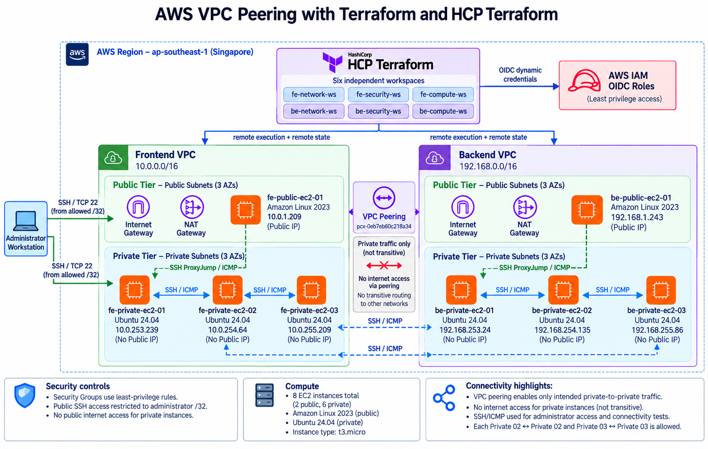
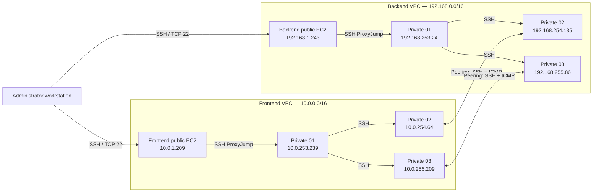

# AWS VPC Peering with Terraform — VCS-Driven Workflow

**A multi-VPC AWS networking project managed with Terraform and HCP Terraform, using GitHub-based version control to trigger infrastructure plans and manual approval for deployment.**

## Overview

This project demonstrates how to build and validate a multi-VPC network in AWS using Infrastructure as Code (IaC). A frontend VPC and a backend VPC are deployed in the **Asia Pacific (Singapore) (`ap-southeast-1`)** Region, connected by an AWS VPC peering connection, and configured with subnet-specific routing and least-privilege network access rules.

Infrastructure is separated into **network**, **security**, and **compute** layers for each VPC. HCP Terraform manages remote execution and state, and AWS access from HCP Terraform is authenticated through **OIDC-based dynamic provider credentials** rather than long-lived AWS access keys.

This implementation uses the HCP Terraform Version Control Workflow. Each workspace is connected to the corresponding Terraform root directory in GitHub. Repository changes trigger Terraform plans, while infrastructure deployment is controlled through manual apply approval.

### Key capabilities

- Two isolated VPCs with non-overlapping IPv4 CIDR ranges.
- Three Availability Zones per VPC, with three public and three private subnets in each VPC.
- Internet Gateways, NAT Gateways, and public/private route tables.
- Private routing between designated subnet pairs through VPC peering.
- Security Groups with separately managed ingress and egress rules.
- Eight EC2 instances: one public jump host and three private hosts per VPC.
- Multi-hop SSH ProxyJump connectivity without transferring the private SSH key to EC2 instances.
- Six HCP Terraform workspaces with remote-state dependencies.
- Verified private-to-private ICMP and SSH connectivity across the peered VPCs.

## Architecture



### Network connectivity



> **Diagram note:** Instance private addresses are from the verified lab deployment and are illustrative deployment results, not Terraform inputs. Actual addresses can differ on reprovisioning. Public access to jump hosts is restricted to a configured administrator `/32` IPv4 address.

### Network layout

| Component | Frontend | Backend |
| --- | --- | --- |
| VPC CIDR | `10.0.0.0/16` | `192.168.0.0/16` |
| Public subnets | 3, across 3 Availability Zones | 3, across 3 Availability Zones |
| Private subnets | 3, across 3 Availability Zones | 3, across 3 Availability Zones |
| Public EC2 | 1 × Amazon Linux 2023 | 1 × Amazon Linux 2023 |
| Private EC2 | 3 × Ubuntu 24.04 | 3 × Ubuntu 24.04 |
| EC2 size | `t3.micro` | `t3.micro` |
| Internet Gateway | 1 | 1 |
| NAT Gateway | 1 | 1 |
| Public/private route tables | Configured | Configured |
| VPC peering | Shared connection | Shared connection |

The peering connection supports routing between the intended private subnet pairs. **VPC peering is not transitive**; it does not automatically provide connectivity to other VPCs or act as a gateway for internet access.

## Repository structure

```text
aws-vpc-peering-terraform-vcs/
├── assets/           # Architecture diagram
├── fe-network/       # Frontend VPC, subnets, gateways, and routing
├── be-network/       # Backend VPC, subnets, gateways, peering, and routing
├── fe-security/      # Frontend Security Groups and individual rules
├── be-security/      # Backend Security Groups and individual rules
├── fe-compute/       # Frontend EC2 instances and AWS SSH key pair
├── be-compute/       # Backend EC2 instances and AWS SSH key pair
├── .gitignore
└── README.md
```

Each directory is a **separate Terraform root configuration**, connected to its own HCP Terraform workspace. The project intentionally does not use Terraform modules; this makes the dependency boundaries and resource definitions explicit.

## HCP Terraform workspaces

| Directory | Workspace | Responsibility |
| --- | --- | --- |
| `fe-network/` | `fe-network-vcs-ws` | Frontend VPC and network resources |
| `be-network/` | `be-network-vcs-ws` | Backend VPC, networking, and peering connection |
| `fe-security/` | `fe-security-vcs-ws` | Frontend Security Groups and ingress/egress rules |
| `be-security/` | `be-security-vcs-ws` | Backend Security Groups and ingress/egress rules |
| `fe-compute/` | `fe-compute-vcs-ws` | Frontend EC2 instances and public SSH key registration |
| `be-compute/` | `be-compute-vcs-ws` | Backend EC2 instances and public SSH key registration |

The workspaces use **remote execution and remote state**. Required identifiers are exported as outputs and consumed via `terraform_remote_state` instead of being copied into configuration as fixed resource IDs. Security-layer configurations reference the network-layer outputs; compute configurations consume network and security outputs. The two security configurations also reference peer Security Group IDs.

Cross-workspace state access must be authorized through HCP Terraform's state-sharing controls.

### Version Control Workflow

GitHub serves as the source of truth for Terraform configuration. Each HCP Terraform workspace connects to the same repository but uses its own working directory and independent Terraform state.

Changes pushed to the configured branch trigger workspace plans according to the workspace's run-triggering settings. The project uses manual apply approval to review infrastructure changes before provisioning AWS resources.

Pull requests provide an opportunity to review infrastructure changes before merging them into the deployment branch.

## Security design

### AWS authentication

HCP Terraform authenticates to AWS using short-lived dynamic provider credentials configured through AWS Quick Setup. This establishes the required AWS trust configuration and IAM role integration without manually writing the complete IAM trust setup.

IAM permissions are scoped to the AWS resources required by each Terraform workspace. Long-lived AWS access keys are not stored in the repository.

No AWS access keys are required in the repository.

### SSH access

- Public jump hosts run Amazon Linux 2023 and use the `ec2-user` account.
- Private hosts run Ubuntu 24.04 and use the `ubuntu` account.
- Only an SSH **public key** is registered as an AWS EC2 key pair through Terraform.
- The corresponding **private key remains on the administrator's workstation** and must never be committed to source control.
- SSH access to public jump hosts is restricted to an administrator IPv4 `/32` CIDR.
- Private hosts have no public IPv4 addresses and are reached through SSH ProxyJump.
- EC2 instances require IMDSv2.

### Network access rules

| Source | Destination | Allowed traffic |
| --- | --- | --- |
| Configured administrator `/32` | Public jump hosts | SSH and ICMP |
| Public jump host in the same VPC | Private 01 | SSH and ICMP |
| Private 01 in the same VPC | Private 02 and Private 03 | SSH and ICMP |
| Frontend Private 02 ↔ Backend Private 02 | Matching peer | SSH and ICMP |
| Frontend Private 03 ↔ Backend Private 03 | Matching peer | SSH and ICMP |

Private 02/03 egress is intentionally limited to their matching peered Security Groups for the tested protocols. Security Groups are **stateful**, so allowed connection responses do not require a separate reverse-direction rule for each response packet. Other paths should not be presumed permitted without checking the complete effective policy.

## Prerequisites

- An AWS account with permissions to create VPC, EC2, networking, IAM, and associated resources in `ap-southeast-1`.
- An HCP Terraform organization with six workspaces, configured for remote execution and permitted remote-state access.
- Terraform CLI compatible with the repository's `required_version` constraints (developed and tested with Terraform **1.16.6**).
- AWS provider version matching each root configuration's constraint (the lab used the AWS provider **6.x**).
- AWS CLI for verification and troubleshooting.
- OpenSSH and an SSH key pair generated and stored securely on the local workstation.
- Appropriate HCP Terraform workspace variables, including an administrator `/32` CIDR and the SSH public key for compute.
- A GitHub repository connected to HCP Terraform through a VCS connection.
- Six VCS-driven HCP Terraform workspaces with their respective working directories configured.
- AWS Quick Setup authentication with IAM permissions appropriate for each workspace.

**Cost considerations:** NAT Gateways, public IPv4 addresses, EC2 instances, EBS volumes, and other AWS resources may incur charges. NAT Gateways incur hourly charges even when no traffic is being processed. Destroy the infrastructure when it is no longer needed to avoid unnecessary costs.

## Deployment workflow

Infrastructure is deployed through the HCP Terraform Version Control Workflow, with GitHub as the source of Terraform configuration.

1. **Connect GitHub.** Connect the repository to HCP Terraform and configure the appropriate working directory for each of the six workspaces.
2. **Configure AWS authentication.** Use AWS Quick Setup to establish dynamic AWS credentials and assign the necessary IAM permissions.
3. **Configure dependencies.** Enable authorized remote-state sharing between dependent workspaces.
4. **Provision networking.** Trigger and review Terraform plans for the frontend and backend networking workspaces, then approve the required applies.
5. **Provision security.** Deploy frontend and backend Security Groups, resolving cross-workspace dependencies through staged deployment where necessary.
6. **Provision compute.** Deploy the frontend and backend EC2 instances after their network and security dependencies are available.
7. **Validate connectivity.** Test SSH ProxyJump, private ICMP connectivity, and SSH communication across the peered VPCs.
8. **Destroy infrastructure.** Perform dependency-aware teardown through HCP Terraform after validation.

### Change management

Terraform configuration changes are committed to GitHub. HCP Terraform detects relevant changes and generates plans for review.

Infrastructure modifications require manual apply approval. Terraform state remains managed by HCP Terraform rather than being committed to GitHub.

## Previous deployment validation results

The following results were recorded during the previous CLI-driven implementation of the same AWS architecture. Connectivity testing for this VCS-driven deployment will be documented separately after provisioning.

The deployed infrastructure was validated through SSH connectivity, ICMP testing, and cross-VPC communication.

| Test | Source | Target | Result |
|---|---|---|---|
| Public SSH | Administrator workstation | Frontend and backend public EC2 | Passed |
| SSH ProxyJump | Administrator workstation | Frontend and backend Private 01 | Passed |
| ICMP over peering | FE Private 02 | BE Private 02 | 4/4 replies, 0% loss, avg. 0.268 ms |
| ICMP over peering | FE Private 03 | BE Private 03 | 4/4 replies, 0% loss, avg. 0.327 ms |
| SSH over peering | FE Private 02 | BE Private 02 | Passed |
| SSH over peering | FE Private 03 | BE Private 03 | Passed |

Sample commands used from the source private instances:

```bash
# Verify ICMP reachability from frontend Private 02 to backend Private 02.
ping -c 4 192.168.254.135

# Verify ICMP reachability from frontend Private 03 to backend Private 03.
ping -c 4 192.168.255.86
```

For SSH, the administrator workstation used OpenSSH `ProxyJump` aliases to traverse the public EC2 and frontend private hosts before entering the matching backend private EC2. This avoids copying private keys onto intermediate EC2 hosts.

**Validation scope:** ICMP and SSH connectivity were successfully verified between the intended EC2 instances across VPC peering. Tests to confirm that unauthorized connections are blocked were not performed.

## Operational considerations

- **Changing administrator IP:** If the administrator's public IPv4 address changes, update the HCP Terraform administrator CIDR variable in both security workspaces and apply the reviewed security plans.
- **SSH host keys:** Verify SSH host fingerprints through a trusted channel before accepting unfamiliar hosts.
- **AMI updates:** A `most_recent` AMI data source may select a different image over time. Review compute plans carefully because changing an instance AMI may require replacement. Pin AMI identifiers or use a deliberate image versioning strategy for reproducible environments.
- **Remote state:** Store state in HCP Terraform, not Git. Share state only with authorized workspaces.
- **Change management:** Avoid editing Terraform-managed AWS resources manually in the AWS Console, because it may introduce configuration drift.

## Infrastructure teardown

Resources are managed across six independent HCP Terraform workspaces. Infrastructure teardown must account for dependencies between networking, security, and compute resources.

1. Destroy the frontend and backend compute resources.
2. Remove cross-VPC Security Group references before destroying the security resources.
3. Destroy the remaining Security Groups and associated rules.
4. Remove dependent VPC peering routes before destroying the peering connection and network resources.
5. Verify that all Terraform-managed AWS resources have been removed.

Terraform does not automatically resolve dependencies across independent workspaces, so resource destruction must follow the appropriate dependency order.


## Repository hygiene

The repository follows Terraform and Git security practices to protect sensitive information and maintain reproducible deployments.

- Terraform state files, local `.terraform/` directories, execution plans, credentials, and sensitive variable files are excluded from version control.
- `.terraform.lock.hcl` files are version-controlled to maintain consistent provider selections.
- SSH private keys and workstation-specific SSH configurations are maintained outside the repository.
- Sensitive configuration values and AWS authentication settings are managed through HCP Terraform workspace variables and AWS IAM.
- Repository contents are reviewed to prevent accidental exposure of credentials and sensitive infrastructure information.

## Technical highlights

This project implements AWS VPC networking and cross-VPC connectivity using Terraform and HCP Terraform. Key technical components include subnet routing, VPC peering, granular Security Group rules, secure multi-hop SSH access, OIDC-based AWS authentication, remote Terraform state integration, and infrastructure management across six independent workspaces.

---

**Project status:** VCS workflow configuration in progress. Deployment and connectivity validation pending.
